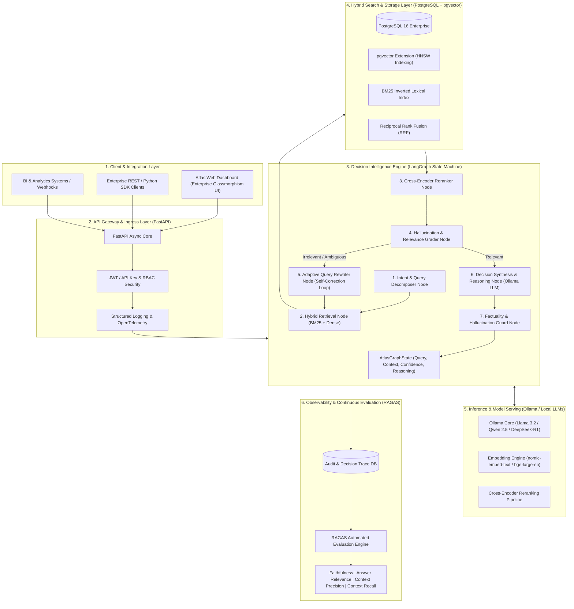

# Atlas — Enterprise AI Knowledge & Decision Intelligence Platform

[](https://www.python.org/)
[](https://fastapi.tiangolo.com/)
[](https://github.com/langchain-ai/langgraph)
[](https://github.com/pgvector/pgvector)
[](https://ollama.ai)
[](https://github.com/explodinggradients/ragas)
[](https://www.docker.com/)

---

## 1. System Overview

**Atlas** is an Enterprise Knowledge & Decision Intelligence Platform engineered for high-accuracy reasoning, verifiable source attribution, and resilient knowledge retrieval across complex enterprise data silos.

Unlike naive RAG systems that rely solely on flat cosine similarity, Atlas implements an **Adaptive Multi-Agent Decision Engine** powered by:
- **FastAPI (Async Core)**: High-throughput async RESTful gateway with streaming, lifespans, and telemetry.
- **PostgreSQL 16 + pgvector**: Dense embeddings (768-d HNSW indexing with $m=16, ef\_construction=64$).
- **Sparse BM25 Search**: Full-text inverted index with Porter stemming and Robertson-Jones IDF.
- **Reciprocal Rank Fusion (RRF)**: Rank-based fusion balancing semantic context and lexical keyword precision.
- **Cross-Encoder Reranking**: Second-stage deep attention scoring eliminating false-positive semantic matches.
- **LangGraph Multi-Agent Engine**: Adaptive state machine with query decomposition, self-correction rewriting loops, and factuality guards.
- **Ollama Local LLM Serving**: Privacy-preserving, on-premises LLM orchestration (`llama3.2`, `qwen2.5`, `nomic-embed-text`).
- **RAGAS Automated Evaluation**: Automated auditing for **Faithfulness**, **Answer Relevance**, **Context Precision**, and **Context Recall**.
- **Enterprise Web Dashboard**: Interactive UI featuring real-time LangGraph step animations, hybrid search rank explorer, and citation verification.

---

## 2. Production Architecture Diagram



---

## 3. Quick Start & Production Deployment

### Option A: Complete Docker Compose Deployment (Recommended for Production)

Ensure Docker & Docker Compose are installed:

```bash
# 1. Clone & enter repository
cd d:\AGENTS

# 2. Launch PostgreSQL (pgvector), Ollama, and Atlas API
docker compose up -d

# 3. Pull recommended models into Ollama container
docker exec -it atlas_ollama ollama pull llama3.2
docker exec -it atlas_ollama ollama pull nomic-embed-text
```

The services will be live at:
- **Web Dashboard**: `http://localhost:8000`
- **Interactive OpenAPI Docs**: `http://localhost:8000/docs`
- **Health Probe**: `http://localhost:8000/api/v1/health`

---

### Option B: Local Standalone Development

Atlas supports standalone development with automated SQLite fallback when PostgreSQL is not running:

```bash
# 1. Install dependencies
pip install -r requirements.txt

# 2. Run the platform
python -m uvicorn app.main:app --host 0.0.0.0 --port 8000 --reload
```

---

## 4. API Endpoints Reference

| Method | Endpoint | Description |
| :--- | :--- | :--- |
| `GET` | `/api/v1/health` | Comprehensive readiness probe (DB, Ollama, Vector Indices). |
| `POST` | `/api/v1/query` | Executes the LangGraph Multi-Agent Decision Intelligence workflow. |
| `POST` | `/api/v1/search` | Inspects Dense vs BM25 vs RRF vs Cross-Encoder rankings. |
| `POST` | `/api/v1/documents` | Ingests enterprise documents with recursive chunking & embeddings. |
| `GET` | `/api/v1/documents` | Lists all indexed documents and chunk statistics. |
| `DELETE`| `/api/v1/documents/{id}`| Deletes a document and cascade removes its vector chunks. |
| `POST` | `/api/v1/evaluate` | Runs the RAGAS Quality Assurance benchmark. |

---

### Example: Decision Intelligence Request

```bash
curl -X POST http://localhost:8000/api/v1/query \
  -H "Content-Type: application/json" \
  -d '{
    "query": "What are our SLA targets for decision latency and how does disaster recovery handle RTO?",
    "evaluate_with_ragas": true,
    "max_rewrite_cycles": 2
  }'
```

---

## 5. Continuous Evaluation with RAGAS

Atlas enforces continuous evaluation across four dimensions:
1. **Faithfulness**: Verifies that every assertion made by the LLM is substantiated by citations.
2. **Answer Relevance**: Ensures answers directly resolve the user's inquiry without drift.
3. **Context Precision**: Confirms that top-ranked chunks have higher evidentiary value than lower-ranked ones.
4. **Context Recall**: Verifies that no ground-truth requirements were missed during retrieval.

---

## 6. Running Tests

```bash
pytest -v
```
